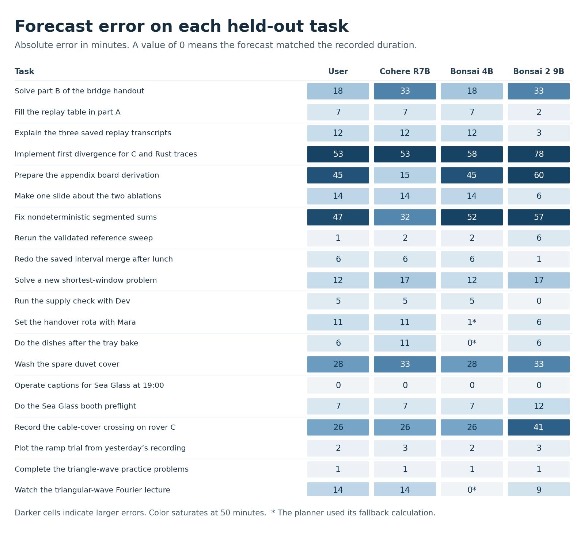

# Bonsai 4B and 9B on the planner's 20 held-out tasks

Cohere Command R7B had the lowest mean absolute error on the **16 tasks where all three models returned a valid forecast**. Cohere missed the recorded duration by 16.62 minutes on average, compared with 17.75 for the user's estimate, 18.44 for Bonsai 4B and 22.06 for Bonsai 9B. All three models received the same task scope, selected historical work and original time estimate.

## Accuracy

Each cell is mean absolute error in minutes. The first three rows include the forecasts that the app would show, including its fallback when a model fails.

| Cohort | Tasks | User | Cohere R7B | Bonsai 4B | Bonsai 9B |
| --- | ---: | ---: | ---: | ---: | ---: |
| All held-out tasks | 20 | 15.75 | 15.10 | **14.80** | 18.70 |
| Flexible tasks | 19 | 16.58 | 15.89 | **15.58** | 19.68 |
| Retrieval-validation profiles | 10 | 15.10 | **13.70** | 13.80 | 17.20 |
| Valid model response from all three | 16 | 17.75 | **16.62** | 18.44 | 22.06 |

The app's 0.30-minute advantage with 4B on all 20 cases came from three historical calculations. On the Mara meeting, dishes and Fourier lecture, both 4B attempts reached the 950-token limit. The fallback predicted 40, 36 and 54 minutes against actuals of 41, 36 and 54. Its error averaged **0.33 minutes** on those three tasks. Cohere averaged 12.00 minutes and the user averaged 10.33 on the same three. On the 16 tasks where 4B supplied the point estimate, it copied the user 13 times. Each of its three changes increased the error.

| Model-authored flexible forecasts | Valid / attempted | Raised user's estimate | Kept it | Lowered it | Mean signed error |
| --- | ---: | ---: | ---: | ---: | ---: |
| Cohere R7B | 19/19 | 2 | 11 | 6 | −9.58 min |
| Bonsai 4B | 16/19 | 0 | 13 | 3 | −12.56 min |
| Bonsai 9B | 19/19 | 2 | 2 | 15 | −19.26 min |

9B shortened 15 of 19 estimates. That helped on some short tasks. On the five flexible tasks with no selected timing history, 9B averaged 10.60 minutes of error, against 12.00 for each of the other three methods. On the 14 with selected history its error rose to 22.93, compared with 17.29 for Cohere, 16.86 for the 4B configuration including fallbacks, and 18.21 for the user.

## Ranges and warnings

| Flexible tasks | Actual inside interval | Mean interval width | Warnings citing expected source | Any warning | Cited expected timing example |
| --- | ---: | ---: | ---: | ---: | ---: |
| Cohere R7B | 5/19 | 15.63 min | 3/5 | 13/19 | 13/18 |
| Bonsai 4B, including fallback | 10/19 | 22.16 min | 2/5 | 3/19 | 13/18 |
| Bonsai 9B | 10/19 | 20.84 min | 0/5 | 0/19 | 13/18 |

The wider Bonsai intervals covered five more flexible tasks than Cohere's. The 4B model itself covered 7/16 and emitted no warnings. Its three fallback intervals all covered the actual time and supplied both credited warnings. 9B returned a valid forecast for all 19 flexible tasks and emitted no warnings. All three configurations cited at least one expected comparison on the same number of tasks. The appendix derivation shows why that alone can be a poor measure of forecast quality.

## What happened on individual tasks

- **Appendix board derivation.** The user estimated 60 minutes and spent 105. 9B cited all three pertinent examples, where 60, 50 and 55 minutes of expected work took 104, 86 and 97 minutes. It then lowered this task to **45 minutes (30–60)**. 4B cited the 50→86-minute lemma and returned **60 (45–75)**. Cohere forecast **120 (100–140)**.
- **C and Rust trace work.** With no selected timing comparison, 9B reduced a transcript write-up from 40 to 25 minutes, close to the actual 28. On the implementation task it reduced 85 to 60, even though it cited an 80-minute mismatch reporter that took 118. The implementation took 138 minutes. 4B predicted 80 and Cohere predicted 85.
- **Handover meeting with Mara.** Cohere kept the 30-minute point. It earned source credit by citing the right meetings, although its advice focused on off-task activity and omitted Mara's late arrivals. 9B estimated 35 minutes and supplied no warning. When 4B exhausted its response budget, the app's historical calculation returned 40 minutes with a warning grounded in the user's notes. The meeting took 41.



<details>
<summary>All task durations and point forecasts in minutes</summary>

| Profile | Task | User | Actual | Cohere R7B | Bonsai 4B | Bonsai 9B |
| --- | --- | ---: | ---: | ---: | ---: | ---: |
| 01 | Solve part B of the bridge handout | 75 | 93 | 60 | 75 | 60 |
| 01 | Fill the replay table in part A | 30 | 23 | 30 | 30 | 25 |
| 02 | Explain the three saved replay transcripts | 40 | 28 | 40 | 40 | 25 |
| 02 | Implement first divergence for C and Rust traces | 85 | 138 | 85 | 80 | 60 |
| 03 | Prepare the appendix board derivation | 60 | 105 | 120 | 60 | 45 |
| 03 | Make one slide about the two ablations | 45 | 31 | 45 | 45 | 25 |
| 04 | Fix nondeterministic segmented sums | 85 | 132 | 100 | 80 | 75 |
| 04 | Rerun the validated reference sweep | 60 | 61 | 59 | 59 | 55 |
| 05 | Redo the saved interval merge after lunch | 25 | 19 | 25 | 25 | 20 |
| 05 | Solve a new shortest-window problem | 50 | 62 | 45 | 50 | 45 |
| 06 | Run the supply check with Dev | 20 | 15 | 20 | 20 | 15 |
| 06 | Set the handover rota with Mara | 30 | 41 | 30 | 40 (fallback) | 35 |
| 07 | Do the dishes after the tray bake | 30 | 36 | 25 | 36 (fallback) | 30 |
| 07 | Wash the spare duvet cover | 30 | 58 | 25 | 30 | 25 |
| 08 | Operate captions for Sea Glass at 19:00 (scheduled) | 75 | 75 | 75 | 75 | 75 |
| 08 | Do the Sea Glass booth preflight | 30 | 37 | 30 | 30 | 25 |
| 09 | Record the cable-cover crossing on rover C | 45 | 71 | 45 | 45 | 30 |
| 09 | Plot the ramp trial from yesterday’s recording | 40 | 38 | 35 | 40 | 35 |
| 10 | Complete the triangle-wave practice problems | 45 | 44 | 45 | 45 | 45 |
| 10 | Watch the triangular-wave Fourier lecture | 40 | 54 | 40 | 54 (fallback) | 45 |

</details>

## Inference time

| Flexible forecasts | Recorded HTTP responses | Median provider time per task | Mean provider time per task |
| --- | ---: | ---: | ---: |
| Cohere R7B | 19 | 6.95 s | 7.15 s |
| Bonsai 4B | 22 | 307.43 s | 501.13 s |
| Bonsai 9B | 19 | 272.38 s | 275.46 s |

Provider time sums the recorded requests for each task, including model retries. The Cohere times come from the original live provider receipts. Four concurrent tasks shared each CPU-only Bonsai server. These measurements describe this machine and workload. The 4B run also had one interrupted connection during the Fourier correction. The correction was reissued with identical settings. The reissued request reached the token limit again. Its duration is counted. The interrupted attempt had no measured duration. [4B runtime and incident](bonsai-4b/runtime.json) · [9B runtime](bonsai-9b/runtime.json)

## Method and reproduction

The 20 held-out tasks come from ten synthetic histories. Each profile contributes two tasks. Profiles 02, 04, 06, 08 and 10 form the ten-task retrieval-validation set. The 75-minute scheduled event in profile 08 bypasses inference and always contributes zero error. The forecasts use each task's description, any submitted PDF and its eligible completed history. The held-out duration and grading labels are available only to the scorer.

Each runner verified the ordered Qwen results and Kev decisions against the instructed Cohere run. It also matched the first forecast request on messages, schema, token budget and temperature. Qwen3-Embedding-0.6B used the instruction prefix and a cosine floor of 0.50. Cohere's previously recorded Command R7B forecasts supply the hosted reference. Both local models used PrismML's ternary GGUF weights with CPU inference in LM Studio's bundled llama.cpp runtime. The checkpoint manifests identify the exact weights and runtime settings.

Mean absolute error gives each task equal weight. An interval covers a task when the recorded duration falls between its reported lower and upper bounds, inclusive. A warning earns credit when it cites a historical task named in the prewritten rubric for that warning. Evidence credit checks the cited source, so it cannot establish the quality of the model's advice on its own.

Recompute the tables from the saved case records with Python's standard library. The scorer checks the case IDs, actuals, user estimates and ordered historical selections before calculating the metrics.

```sh
python data/results/holdouts/2026-11-15-bonsai-direct-050/score.py
```

[4B case records](bonsai-4b/cases/) · [9B case records](bonsai-9b/cases/) · [Cohere case records](../2026-11-15-qwen-query-instruction/instructed/) · [Cohere HTTP receipts](../2026-11-15-qwen-query-instruction/requests.json) · [Complete metrics](summary.json)

## Repeating the historical inference

The two runs used different HTTP timeout settings. These checkouts match the estimator, retrieval, client and runner hashes in their respective published manifests. Start each model separately with the weights and server flags recorded in its runtime file. The examples read the absolute GGUF paths from `BONSAI4_GGUF` and `BONSAI9_GGUF`. Run the following from the current repository root. [4B runtime](bonsai-4b/runtime.json) · [9B runtime](bonsai-9b/runtime.json)

```sh
git worktree add --detach ../plan-heldout-4b f95f54e9abfbe45329fd1f604470445937965e92
git worktree add --detach ../plan-heldout-9b b6b77df1d98ac9311056e34da00f093fb7a90caa
(cd ../plan-heldout-4b && python -m examples.estimation.bonsai_holdouts data/results/local/repeat-4b --model ternary-bonsai-4b --weights "$BONSAI4_GGUF" --endpoint http://127.0.0.1:1243/v1/chat/completions)
(cd ../plan-heldout-9b && python -m examples.estimation.bonsai_holdouts data/results/local/repeat-9b --model ternary-bonsai-2-9b --weights "$BONSAI9_GGUF" --endpoint http://127.0.0.1:1243/v1/chat/completions)
```

Add `--preflight` to verify all 20 fixtures, Qwen/Kev selections and initial forecast requests before making model calls.
